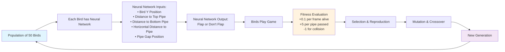
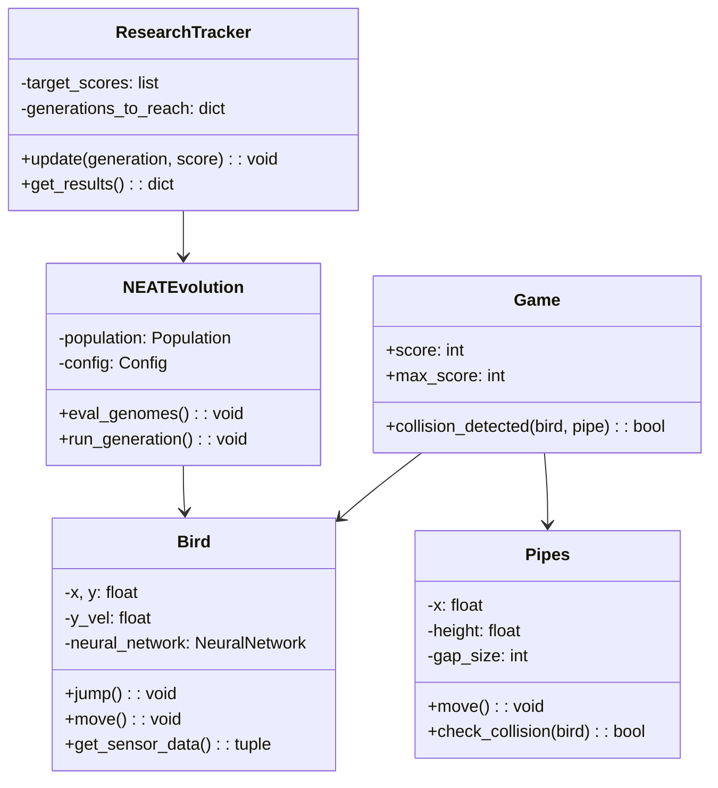

# Flappy Bird - Genetic Learning Project

This project demonstrates the power of neuroevolution using the NEAT (NeuroEvolution of Augmenting Topologies) algorithm to train artificial intelligence agents to play Flappy Bird autonomously. The AI learns through evolutionary processes, where successful birds pass their "genes" to the next generation, gradually improving gameplay over time.

## How It Works

The project uses genetic algorithms and neural networks to evolve birds that can navigate through pipes without human intervention. Each bird has its own neural network that processes environmental data and decides whether to flap or not.



## Core Components

### game_ai.py - The AI Training Engine

This is the heart of the genetic learning system. It implements:

**Neural Network Architecture:**
- **Inputs (5):** 
  - Bird's Y position
  - Distance to pipe gap center
  - Distance to pipe bottom
  - Horizontal distance to pipe leading edge
  - Horizontal distance to pipe trailing edge
- **Hidden Layers:** Variable (evolved by NEAT)
- **Output:** Single neuron determining whether to flap (>0.5) or glide

**Key Features:**
- **Population Management:** Handles 50 birds simultaneously per generation
- **Fitness Function:** Rewards survival time (+0.1/frame) and pipe passage (+5/pipe), penalizes collisions (-1)
- **Real-time Visualization:** Red lines show each bird's sensor inputs to the nearest pipe
- **Physics Matching:** Identical physics to the base game for consistent training
- **Generation Tracking:** Displays current generation, alive count, score, and max score achieved

**Evolution Process:**
1. Initialize 50 random neural networks
2. Each bird processes sensor data through its network
3. Networks output flap decisions
4. Fitness scores accumulate based on performance
5. Best performers selected for reproduction
6. Networks undergo mutation and crossover
7. Process repeats with new generation

### research_study.py - Systematic Experimentation

This module conducts comprehensive research on how environmental parameters affect learning:

**Research Parameters:**
- **Pipe Gap Sizes:** Tests various window sizes (150-350 pixels)
- **Pipe Spacing:** Analyzes different horizontal distances between pipes (300-700 pixels)
- **Target Metrics:** Tracks generations needed to reach scores of 10, 20, 50, 100, 200

**Study Design:**
- Multiple runs per configuration for statistical significance
- Automated result collection in CSV format
- Headless operation for faster experimentation
- Configurable through `research_config.py`

**Data Collection:**
- Generation count to reach target scores
- Maximum score achieved per configuration
- Success rates across different parameter combinations
- Performance trends and optimal configurations

## Architecture Overview



## Getting Started

### Prerequisites
- Python 3.12.4+
- pip package manager

### Installation

1. **Clone the repository:**
   ```bash
   git clone https://github.com/chiraggulati098/flappyBird_geneticLearning.git
   cd flappyBird_geneticLearning
   ```

2. **Install dependencies:**
   ```bash
   pip install -r requirements.txt
   ```

### Usage Options

#### Train AI (Single Run)
```bash
python game_ai.py
```
Watch birds evolve in real-time with visual feedback.

#### Play Manually
```bash
python base_game.py
```
Experience the original game with keyboard controls (SPACE or UP arrow).

#### Run Research Study
```bash
python research_study.py
```
Conduct systematic experiments across multiple parameter configurations.

#### Configure Research
Edit `research_config.py` to customize:
- Environment parameters to test
- Target scores to track
- Number of runs per configuration
- Training duration and population size

## Results and Analysis

The research study generates CSV files with detailed metrics:
- **Convergence Speed:** How quickly AI reaches target scores
- **Parameter Sensitivity:** Which environmental factors most affect learning
- **Optimal Configurations:** Best settings for fastest/most reliable training
- **Statistical Significance:** Multiple runs provide confidence intervals

## Technical Details

**NEAT Algorithm Configuration:**
- Population Size: 50
- Activation Function: tanh
- Initial Topology: Fully connected
- Mutation Rates: Tuned for steady evolution
- Species Threshold: 3.0 for diversity maintenance

**Performance Optimizations:**
- Collision detection using pygame masks
- Efficient pipe management with circular buffer
- Optional headless mode for research studies
- Frame limiting prevents infinite loops